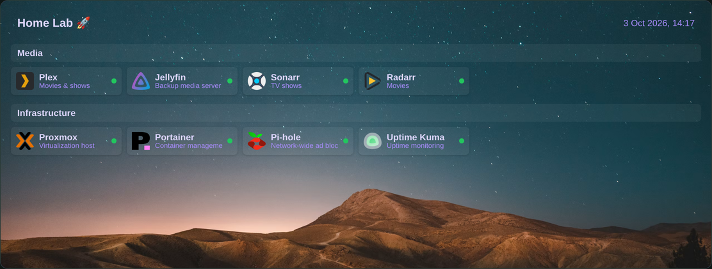
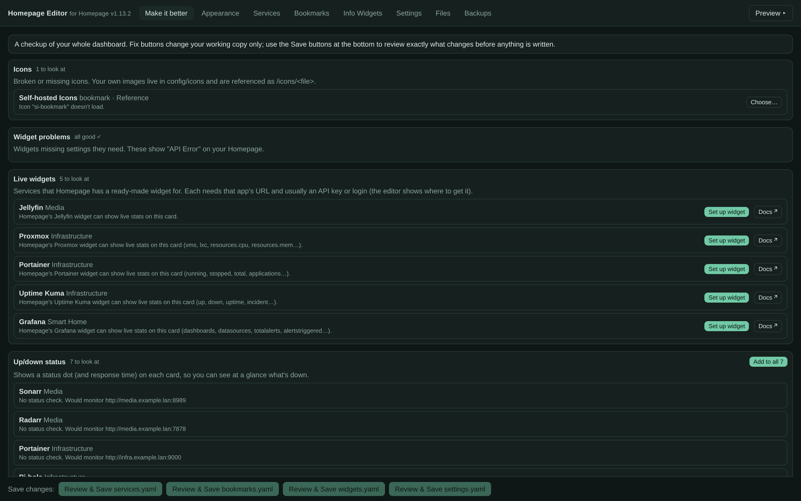
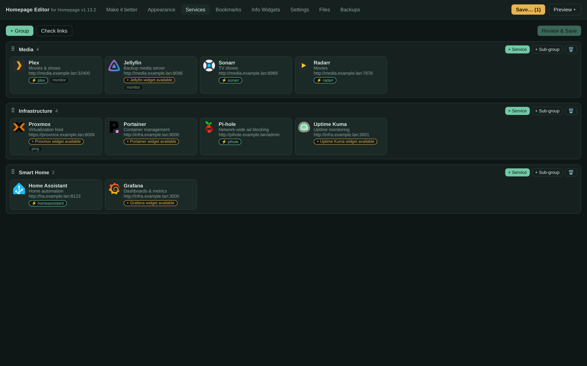
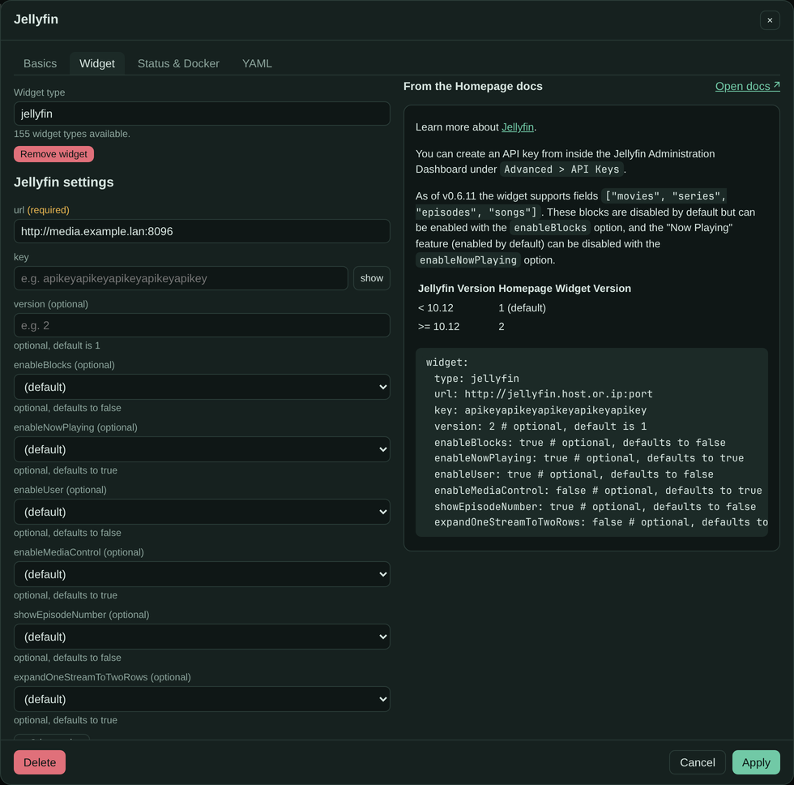
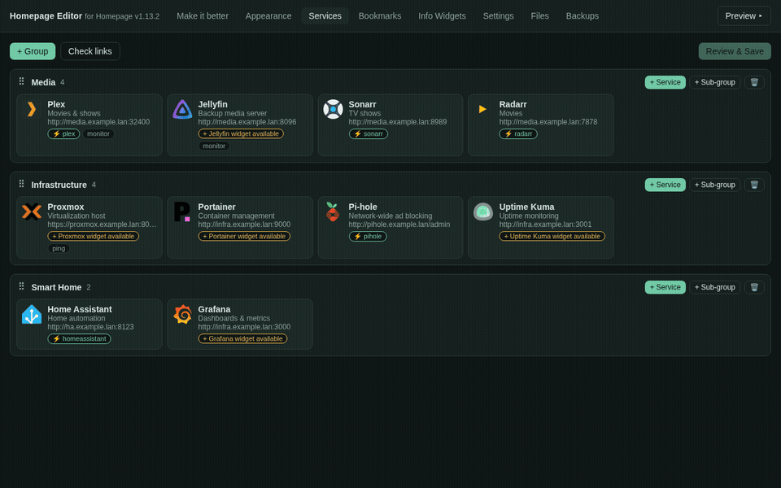
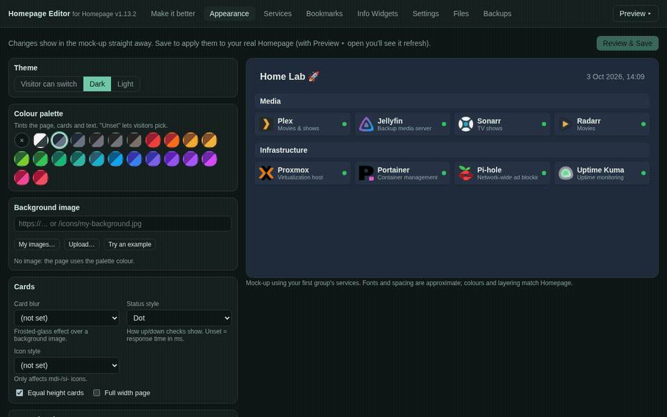
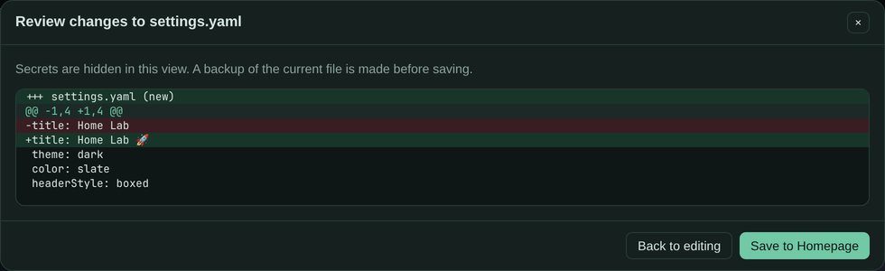

# Homepage Editor

A web UI for editing a [Homepage](https://gethomepage.dev) dashboard's config files in place, for
people who'd rather not hand-edit YAML. It runs in its own container next to Homepage, reads and
writes the exact same `config` folder, and gets out of the way the moment you want to drop back
into the files yourself.



> Built against Homepage **v1.13.2** (155 service widgets, 12 info widgets — see
> [Updating the widget catalog](#updating-the-widget-catalog)). Every screenshot below is a throwaway
> demo config — nothing in this repo points at anyone's real dashboard.

## Why

Homepage's config is just YAML, which is great until you're nudging icon paths, hunting for the
right widget fields, or trying to remember whether a card needs `siteMonitor` or `ping`. This isn't
a replacement dashboard builder — Homepage still renders your dashboard exactly as it always has.
It's a focused editor for the config files underneath it, with Homepage's own docs built in so you
don't need a second tab open to remember what a field does.

## What it does

- **Make it better** — a one-click checkup of the whole dashboard:
  - broken or missing icons
  - services that Homepage has a live widget for, but isn't using
  - cards with no up/down status check
  - a tidy layout and theme preset
  - top-bar info widgets
  - dead links, duplicate entries, and API keys sitting in plain text

  

- **Services / Bookmarks** — cards grouped exactly as they are on the dashboard, with drag-and-drop
  between groups. Each entry gets:
  - an icon picker that searches [Dashboard Icons](https://github.com/homarr-labs/dashboard-icons),
    [selfh.st](https://selfh.st/icons/), Material Design and Simple Icons — or upload an image, or
    pull one straight from a URL
  - a **widget helper** that builds a real form for any of Homepage's service widgets, pulled from
    Homepage's own docs, with those docs shown right beside the form
  - a plain YAML tab for anything the form doesn't cover

  
  
  

- **Appearance** — theme, palette, background image (with blur/saturation/brightness), card and
  header styles, previewed instantly against your own services before you touch a real file.

  

- **Info widgets** and a **Settings explorer** — every documented option, with a "Use this" button
  on every example from the docs
- **Files** tab for anything else, as plain text
- **Safe saves, every time:**
  - your comments, ordering and commented-out blocks survive edits — it merges into the existing
    YAML document instead of rewriting it
  - every save shows you a diff first
  - invalid YAML is refused, and so is a save if the file changed underneath you since you opened it
  - a backup is written before every save, restorable from the Backups tab

  

## Quick start

Homepage Editor runs as its own container, pointed at the same config folder Homepage uses.

1. Either clone this repo and edit the `compose.yaml` it ships with (run it from inside the clone: it builds
   from the `Dockerfile` next to it), or save the one below anywhere you like (it builds straight from this
   GitHub repo, so it doesn't need a clone). Either way, point the two volume lines at your own Homepage config:

   ```yaml
   services:
     homepage-editor:
       # Builds from GitHub, so this file works in any folder. (The compose.yaml in the repo uses
       # `build: .` instead, and must be run from inside the clone.)
       build: https://github.com/jchisholm59/homepage-editor.git#main
       container_name: homepage-editor
       restart: unless-stopped
       ports:
         - "7200:7200"
       environment:
         # Only needed if Homepage isn't on the same Docker network — see below.
         HOMEPAGE_URL: http://homepage:3000
         HOMEPAGE_CONTAINER: homepage
         DOCKER_PROXY: http://docker-restart-proxy:2375
         EDITOR_PASSWORD: ${EDITOR_PASSWORD:-}
       volumes:
         - /path/to/your/homepage/config:/config
         - /path/to/your/homepage/editor-backups:/backups
       depends_on:
         - docker-restart-proxy

     # Lets the editor restart Homepage (needed after adding icons/backgrounds) and nothing else:
     # only container stop/restart/kill is allowed — no exec, no creating containers, no images.
     docker-restart-proxy:
       image: tecnativa/docker-socket-proxy:latest
       container_name: homepage-editor-docker-proxy
       restart: unless-stopped
       environment:
         POST: 1
         ALLOW_RESTARTS: 1
         EVENTS: 0
       volumes:
         - /var/run/docker.sock:/var/run/docker.sock:ro
   ```

2. Point the two volume lines at the same folders your Homepage container mounts for `config` and
   wherever you'd like backups kept.
3. If you want a login, put `EDITOR_PASSWORD=...` in a `.env` file next to `compose.yaml` (any
   username works — it's a single shared password, not a user system).
4. ```
   docker compose up -d --build
   ```
5. Open `http://<this-host>:7200`.

### Environment variables

| Variable             | Default               | What it's for                                                          |
|-----------------------|------------------------|-------------------------------------------------------------------------|
| `PORT`                | `7200`                 | Port the editor listens on                                              |
| `CONFIG_DIR`          | `/config`              | Where Homepage's config is mounted inside the container                 |
| `BACKUP_DIR`          | `/backups`             | Where pre-save backups are written                                      |
| `HOMEPAGE_URL`        | `http://homepage:3000` | Homepage's own address, used to ask it to revalidate and to check icons |
| `HOMEPAGE_CONTAINER`  | `homepage`             | Homepage's container name, for the optional restart button              |
| `DOCKER_PROXY`        | *(unset)*              | A restart-only Docker API proxy; omit to disable the restart button     |
| `EDITOR_PASSWORD`     | *(unset)*              | If set, requires HTTP Basic auth (any username) to use the editor       |

If Homepage isn't reachable at `http://homepage:3000` (for example, it's not on the same Docker
network), set `HOMEPAGE_URL` to its actual address, e.g. `http://192.168.1.10:3000`.

### Custom icons

Homepage only serves your own icons when `config/icons` is *also* mounted at
`/app/public/icons` in **Homepage's own** compose file:

```yaml
    volumes:
      - /path/to/your/homepage/config/icons:/app/public/icons
```

Then reference them as `/icons/<file>`. The editor checks whether this is already in place and
walks you through it under "Make it better" if it isn't.

## Development

```
npm install
CONFIG_DIR=/path/to/a/copy/of/config BACKUP_DIR=/tmp/backups PORT=7299 node server.js
```

Point it at a **copy** of your config, never the live one, while you're poking at it. Two checks
exist for anyone touching the save path:

- `node scripts/roundtrip-test.mjs <config-copy>` — loading and re-saving a file must not change
  its content.
- `node scripts/edit-test.mjs <config-copy>` — typical structured edits must produce minimal diffs
  (comments, ordering and quoting preserved).

## Updating the widget catalog

`catalog/catalog.json` is generated from Homepage's own docs, for whichever Homepage version
you're targeting. Rebuild it after a Homepage upgrade:

```
git clone --depth 1 --branch vX.Y.Z https://github.com/gethomepage/homepage.git /tmp/homepage-src
node scripts/build-catalog.mjs /tmp/homepage-src vX.Y.Z
```

## Contributing

Issues and pull requests welcome — this started as a personal itch-scratcher for one Homepage
setup, so if something assumes too much about how *your* dashboard is laid out, that's a bug, not
a feature.

## License

[MIT](LICENSE)
